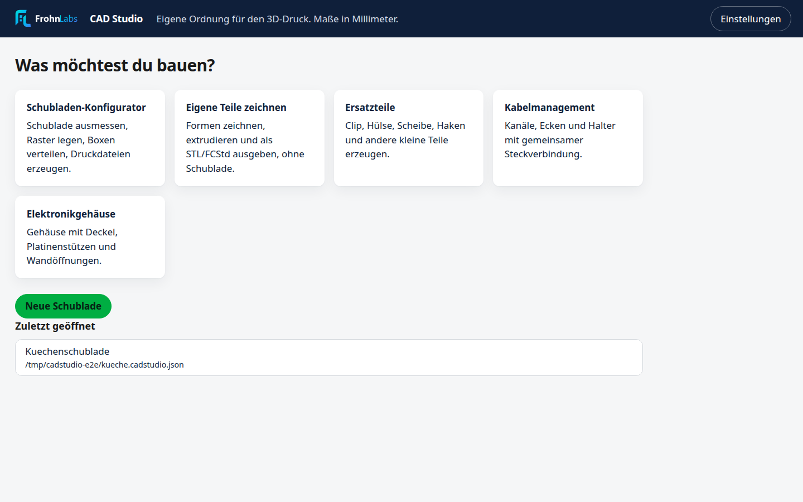
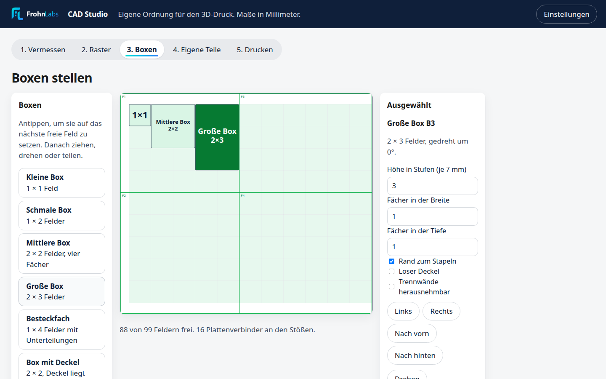
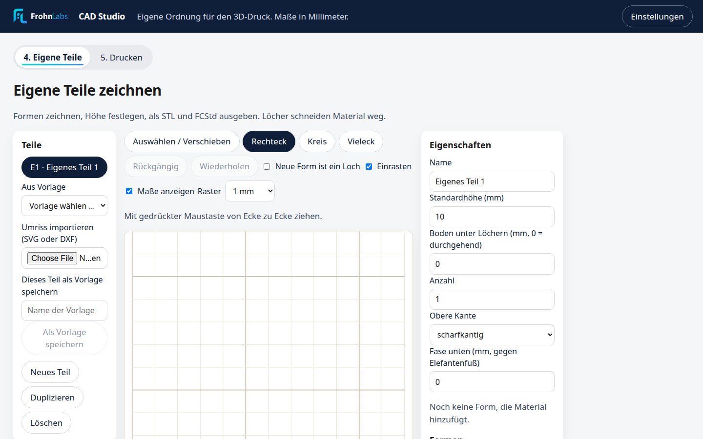
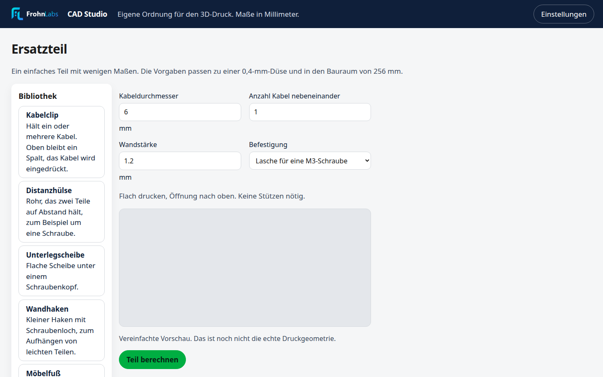
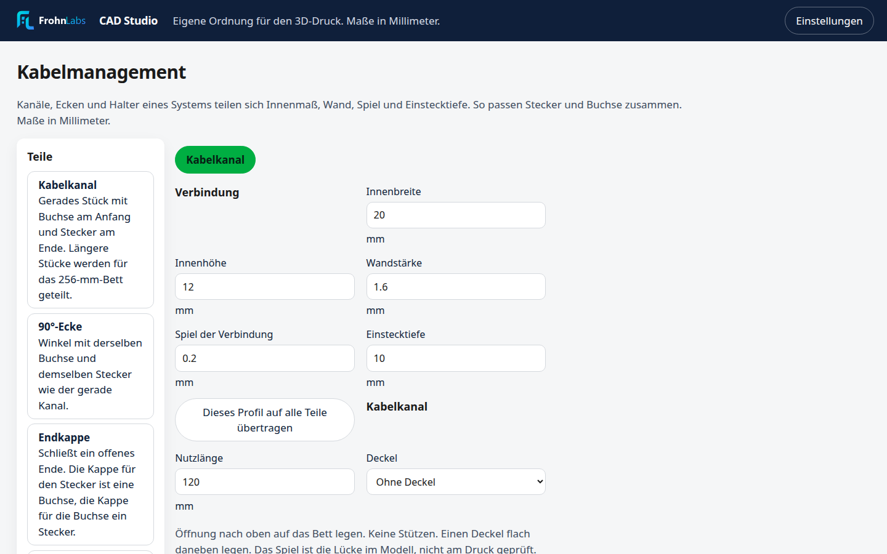
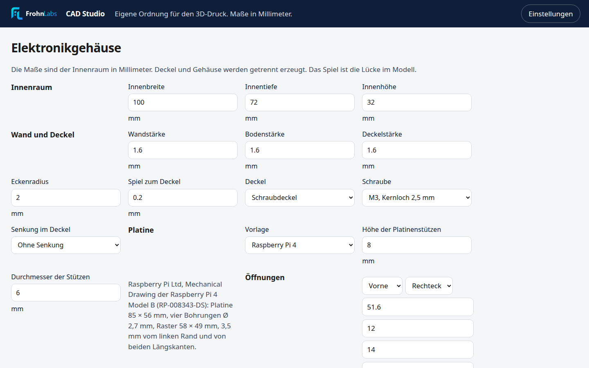

# CAD Studio

Windows-Programm für eigene 3D-Druck-Entwürfe. Die Oberfläche ist Deutsch, die Maße sind Millimeter. Oben steht die FrohnLabs-Wortmarke auf dunkelblauem Grund, Aktionen sind in Bambu-Grün, der Arbeitsbereich ist hell.

Der Druckerbezug ist ein Bambu Lab P2S, Bauraum 256 × 256 × 256 mm. Das Raster kommt aus Hausraster 0.2-qs1: 42 mm je Feld, 7 mm je Höhenstufe, anschlussfähig an Gridfinity. Es wird nur diese korrigierte Generatorversion verwendet. Die älteren Grundplatten ohne QS1 sind fehlerhaft und werden nicht geladen. Die Körper baut FreeCADCmd 1.1.x. CAD Studio enthält keine eigene CAD-Engine und liefert FreeCAD nicht mit.

## Module

| Bereich | Was er tut |
|---|---|
| Schubladen-Konfigurator | Schublade ausmessen, Raster und Grundplatten, Boxen setzen, STL, FCStd, Stückliste und Montageplan |
| Eigene Teile zeichnen | Rechtecke, Kreise, Vielecke, Löcher, Stufen, Fasen, SVG/DXF-Umrisse, auch ohne Schublade |
| Ersatzteile | Kabelclip, Distanzhülse, Unterlegscheibe, Wandhaken, Möbelfuß, Drehknopf, Stopfen, Winkel |
| Kabelmanagement | Kanal mit Stecker und Buchse, 90°-Ecke, Endkappe, Wandhalter, Auslass; gemeinsames Profil, Spiel 0,20 mm im Modell |
| Elektronikgehäuse | Innenmaß, Schraub- oder Schiebedeckel, Platinenstützen (Pi 4, Pi 5, Arduino Uno R3), Öffnungen |

Ein Export gilt nur, wenn die Datei existiert, das Netz geschlossen ist und die FCStd-Datei einen gültigen Körper enthält.













## Architektur

Die Oberfläche ist eine Tauri-2-Anwendung mit React und TypeScript. Sie spricht mit einem lokalen Python-Dienst auf `127.0.0.1:47321`. Der Dienst plant die Schublade mit `plane_schublade` aus den mitgelieferten Hausraster-Quellen und startet für die Körper **FreeCADCmd 1.1** als eigenen Prozess. Anfragen und Antworten sind JSON. FreeCAD wird nicht mitgeliefert (Lizenz LGPL-2.0-or-later) und nicht verändert.

Projektdateien sind JSON (`.cadstudio.json`) auf dem eigenen Rechner. Es gibt keine Cloud und kein Abo.

```
geometry/hausraster/   Generator 0.2-qs1 (const, plan, geom, fcstd, Phase 3 und 4, Makros, Workbenches)
sidecar/               Planung, FreeCAD-Sitzung, Exportprüfung, Stückliste, Montageplan,
                       eigenteil.py, autofill.py, ersatzteil.py, kabel.py, gehaeuse.py
ui/                    Deutsche Oberfläche
src-tauri/             Fenster, Start des Dienstes, Dateidialog
examples/              Beispielprojekt der Abnahmeschublade 480 × 420 mm
```

Eine Änderung an einer Box erzeugt die Geometrie neu. Das Tabellenblatt `HIER_MASSE_AENDERN` in den FCStd-Dateien ist nicht live mit dem Körper verbunden; ohne erneuten Generatorlauf bliebe der alte Körper stehen.

Randstreifen, die nicht in eine Außenplatte passen, werden als glatte Füllplatten ohne Verbinder erzeugt.

Schubladenspiel 1,0 mm und Verbinder-Spiel 0,20 mm sind Vorgaben in den Einstellungen und je Projekt änderbar. Sie sind nicht an einem gedruckten Teil geprüft.

## Voraussetzungen unter Windows

1. [FreeCAD 1.1](https://www.freecad.org/) für Windows installieren. Nicht 0.21 und nicht eine andere Hauptversion. Der Installer von CAD Studio enthält FreeCAD nicht.
2. Python braucht der Installer nicht: Er liefert ein eigenes, eingebettetes Python 3.12 mit (siehe unten). Nur wer den Dienst aus den Quellen startet, braucht Python 3.11 oder neuer.
3. Beim ersten Start sucht das Programm FreeCAD in dieser Reihenfolge:
   - Pfad aus den Einstellungen
   - Umgebungsvariable `FREECADCMD` oder `FREECAD_ROOT`
   - `FreeCADCmd.exe` im PATH
   - `%ProgramFiles%\FreeCAD*\bin\FreeCADCmd.exe`, `%ProgramFiles(x86)%\…`, `%LocalAppData%\Programs\FreeCAD*\bin\FreeCADCmd.exe`
   - Deinstallations-Schlüssel der Registry, wenn der Anzeigename FreeCAD enthält

Fehlt FreeCAD 1.1, erscheint ein deutscher Hinweis mit dem typischen Pfad `C:\Program Files\FreeCAD 1.1\bin\FreeCADCmd.exe`. Ein Export ohne diese Version wird nicht als Erfolg gemeldet.

Die Workbenches unter `geometry/hausraster/FreeCAD_Mod` können zusätzlich nach `%APPDATA%\FreeCAD\Mod` kopiert werden, wenn die Modelle auch in der FreeCAD-Oberfläche neu berechnet werden sollen. Die Anwendung selbst braucht das nicht.

## Starten während der Entwicklung

```bash
python3 -m sidecar.server
npm install
npm run dev
```

Die Oberfläche liegt dann auf `http://localhost:1420`. Unter Windows startet die installierte Anwendung den Dienst selbst.

Der Workflow `.github/workflows/windows.yml` baut auf `windows-latest` MSI und NSIS und lädt beide Pakete 14 Tage als Actions-Artifacts hoch, zum Prüfen eines Pull Requests. Die dauerhafte Datei liegt auf der [Releases-Seite](https://github.com/marci210987-ship-it/3dtool/releases). Ein Start auf einem Windows-Rechner ist damit nicht geprüft.

## Bedienung

Ausführlich: [docs/BEDIENUNGSANLEITUNG.md](docs/BEDIENUNGSANLEITUNG.md). Kurz:

1. Bereich auf der Startseite wählen.
2. Bei der Schublade Innenmaß eintragen, Raster erzeugen, Boxen antippen. Auf der Box steht Typ und Feldgröße, eine 1×1-Box nur „1×1“.
3. **Alle Teile berechnen** startet FreeCAD. Grün wird es erst nach der Datei- und Netzprüfung.
4. **Speichern** schreibt eine lokale Datei `.cadstudio.json`.

Beispiel: [examples/schublade_480x420.cadstudio.json](examples/schublade_480x420.cadstudio.json) (480 × 420 mm, vier Boxen, eine davon gedreht, eine in der Höhe geändert).

## Tests

```bash
python3 -m unittest tests.test_layout tests.test_stlcheck tests.test_detect tests.test_projekt tests.test_server tests.test_einbetten
FREECADCMD=/pfad/zu/FreeCADCmd python3 -m unittest tests.test_abnahme tests.test_sonder tests.test_eigenteil tests.test_vorlagen
npm test
npx playwright install chromium   # einmalig
FREECADCMD=/pfad/zu/FreeCADCmd npx playwright test   # startet Dienst und Oberfläche selbst; ohne FREECADCMD entfällt nur der Export
```

Der Workflow `.github/workflows/windows.yml` führt in GitHub Actions auf `windows-latest` zwei Jobs aus. `tests` lädt FreeCAD 1.1.4 (mit Prüfsumme, zwischengespeichert) und führt alle Python-Tests, Vitest, den Build und Playwright mit echtem Export aus. `installer` baut MSI und Setup mit eingebettetem Python, installiert das Setup still auf dem Runner, startet die App und prüft, dass der Dienst auf `/health` antwortet und mit dem mitgelieferten Python läuft.

### Mitgeliefertes Python

`scripts/python_einbetten.py` lädt das „embeddable package“ von Python 3.12.10 von python.org, prüft die feste SHA256-Summe, entpackt es nach `src-tauri/python` und schreibt `python312._pth` so, dass `..` (der Ordner mit `sidecar/` und `geometry/`) auf dem Suchpfad liegt. Tauri legt das als `python/` in den Installationsordner. Der Starter in `src-tauri/src/lib.rs` nimmt dieses Python zuerst und fällt sonst auf `python3`, `python` oder `py` zurück. Dienst und Kindprozesse starten ohne Konsolenfenster; der Dienst schreibt seine Ausgabe nach `%APPDATA%\CADStudio\dienst.log`. Vor einem lokalen Installer-Build einmal `python scripts/python_einbetten.py` ausführen. Der Ordner `src-tauri/python` ist bis auf `.gitkeep` nicht eingecheckt.

`tests/test_abnahme.py` legt die Schublade 480 × 420 mm an, prüft das Raster, verschiebt und dreht Boxen, verlangt eine erkannte Überlappung, speichert in einem frischen Prozess, erzeugt STL und FCStd und lädt die Dateien in einem zweiten FreeCAD-Prozess. Erfolg gibt es nur, wenn die Dateien existieren und die Netzprüfung besteht.

Der Prüfbericht steht in [TESTBERICHT.md](TESTBERICHT.md).

## Installer herunterladen

Die Installer liegen auf der [Releases-Seite](https://github.com/marci210987-ship-it/3dtool/releases) und laufen nicht ab.

- `CAD-Studio-0.3.0-Setup.exe` ist der einfachere Weg.
- `CAD-Studio-0.3.0.msi` ist dasselbe Programm als MSI.

FreeCAD 1.1.x muss separat installiert sein. Der Installer ist nicht code-signiert, Windows SmartScreen kann warnen. Ein Hardware-Test auf Marcels PC ist noch nicht ausgeführt.

Ein Release entsteht nach dem Merge, wenn der Tag `v0.3.0` auf `main` zeigt. Derselbe Lauf lässt sich unter **Actions → Release → Run workflow** mit der Eingabe `v0.3.0` starten. Der Lauf installiert das Setup still und prüft `/health`, bevor die Dateien am Release hängen. Vorher gibt es die Dateien nicht.

## Installer auf dem eigenen Windows-PC prüfen

Diese Schritte sind die Anleitung für den ersten Start. Sie sind kein bereits durchgeführter Test auf Windows-Hardware.

1. Auf der [Releases-Seite](https://github.com/marci210987-ship-it/3dtool/releases) `CAD-Studio-0.3.0-Setup.exe` oder `CAD-Studio-0.3.0.msi` herunterladen.
2. Das Setup ist der einfachere Weg. Windows SmartScreen kann warnen, weil das Paket nicht signiert ist.
3. Python ist nicht nötig, der Installer bringt es mit. Fehlt der Dienst trotzdem („Der lokale Dienst antwortet nicht“), steht die Ausgabe in `%APPDATA%\CADStudio\dienst.log`.
4. [FreeCAD 1.1.x](https://github.com/FreeCAD/FreeCAD/releases/tag/1.1.4) für Windows installieren, zum Beispiel 1.1.4. CAD Studio enthält FreeCAD nicht. Versionen außerhalb von 1.1.x werden abgelehnt.
5. CAD Studio starten. Unter **Einstellungen** auf **FreeCAD suchen** tippen. Gesucht wird in dieser Reihenfolge: gespeicherter Pfad, `FREECADCMD`, `FREECAD_ROOT`, `FreeCADCmd.exe` im PATH, `%ProgramFiles%\FreeCAD*\bin\FreeCADCmd.exe`, `%ProgramFiles(x86)%\…`, `%LocalAppData%\Programs\FreeCAD*\bin\FreeCADCmd.exe`, danach die Deinstallations-Schlüssel der Registry, wenn der Anzeigename FreeCAD enthält. Wenn nichts gefunden wird, den Pfad von Hand eintragen, typisch `C:\Program Files\FreeCAD 1.1\bin\FreeCADCmd.exe`, und erneut suchen. Der Hinweis muss Version 1.1.x nennen.
6. Die Beispieldatei [examples/schublade_480x420.cadstudio.json](examples/schublade_480x420.cadstudio.json) als Rohdatei speichern (auf GitHub **Raw**, nicht die Webseite). In CAD Studio **Öffnen** wählen. Erwartet: Innenmaß 480 × 420 mm, Raster **11 × 9** Felder, vier Grundplatten, vier Boxen. **Alle Teile berechnen** startet FreeCAD und darf erst grün werden, wenn STL und FCStd geschrieben und geprüft sind. Das dauert.
7. Wenn etwas scheitert, diese Angaben schicken: Windows-Version, MSI oder Setup, Inhalt von `%APPDATA%\CADStudio\dienst.log`, der angezeigte FreeCAD-Pfad oder der deutsche Fehlertext wortgetreu, ein Bildschirmfoto, und ob das Beispielprojekt die 11 × 9 Felder gezeigt hat. Den roten Text unter **Nicht exportiert** vollständig übernehmen. Nicht raten, ob ein Druck passen würde.

## Was noch nicht da ist

Freiformflächen, Gewinde, Text und 3D-Skizzen gibt es nicht. Randstreifen sind einfache, glatte Füllplatten ohne Verbinder. Das Spiel an Deckel, Kabeln und Stopfen ist die Lücke im Modell und nicht an einem gedruckten Teil geprüft. Der Windows-Installer wird in GitHub Actions gebaut, dort auf dem Runner gestartet und danach als Release abgelegt. Auf einem echten Windows-PC eines Benutzers wurde er noch nicht geprüft.
